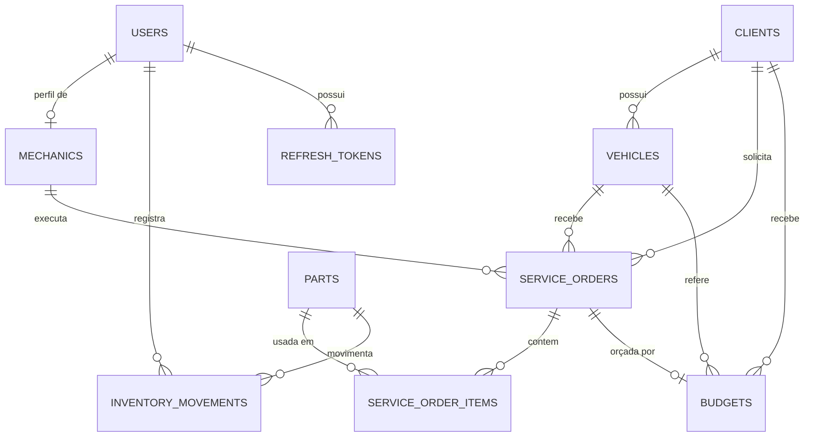

# 🔧 Torque Gestão

<p align="center">
  <strong>Sistema de gestão inteligente para oficinas mecânicas, desenvolvido com Java 21 e Spring Boot.</strong>
  <br>
  Gerencie clientes, veículos, ordens de serviço, orçamentos, estoque, faturamento e equipe em uma única plataforma.
</p>

<p align="center">
  <a href="https://torque-gestao.onrender.com/">
    
  </a>
</p>

<p align="center">
  
  
  
  
  
</p>

---

## 🌐 Demonstração online

Experimente o Torque Gestão diretamente pelo navegador, utilizando a conta de demonstração.

<p align="center">
  <a href="https://torque-gestao.onrender.com/">
    
  </a>
</p>

| Credencial | Acesso |
|---|---|
| **URL** | [torque-gestao.onrender.com](https://torque-gestao.onrender.com/) |
| **E-mail** | `demo@torquegestao.com` |
| **Senha** | `torque@gestao2026!` |

> **Nota:** a demonstração está hospedada no Render. Dependendo da configuração do serviço, a primeira requisição pode levar alguns instantes para responder.

## 📌 Sobre o projeto

O **Torque Gestão** é uma aplicação web para gerenciamento de oficinas mecânicas, desenvolvida com Java 21 e Spring Boot. A plataforma centraliza as principais operações de uma oficina, desde o cadastro de clientes e veículos até o acompanhamento de serviços, controle de peças e cálculo do faturamento.

O sistema implementa um fluxo estruturado de ordens de serviço, com etapas controladas, orçamentos sujeitos à aprovação, lançamento de peças e mão de obra e atualização automática dos valores. O gerenciamento de estoque utiliza movimentações rastreáveis e controle de concorrência para proteger a integridade dos saldos.

A aplicação conta com autenticação e autorização por perfil, interface web com Thymeleaf e API REST protegida por JWT. O PostgreSQL armazena os dados, o Flyway gerencia as migrações e o Redis pode ser utilizado para funcionalidades auxiliares, sem ser obrigatório para a execução do sistema.

O projeto demonstra a aplicação prática de **desenvolvimento backend, regras de negócio, segurança, persistência relacional, transações, testes automatizados e arquitetura em camadas** em um cenário próximo das necessidades reais de uma oficina.

## ✨ Funcionalidades

- 👥 **Gestão de clientes:** cadastro e manutenção de informações.
- 🚗 **Gestão de veículos:** associação de veículos aos respectivos clientes.
- 🔧 **Ordens de serviço:** abertura, atribuição a mecânicos e acompanhamento de status.
- 🧾 **Orçamentos:** elaboração, aprovação e recusa de serviços propostos.
- 💰 **Faturamento:** cálculo automático dos valores de peças e mão de obra.
- 📦 **Controle de estoque:** entradas, saídas e atualização dos saldos.
- 👨‍🔧 **Gestão de mecânicos:** consulta da equipe e controle das ordens atribuídas.
- 📊 **Dashboard gerencial:** acompanhamento das informações operacionais.
- 🔐 **Controle de acesso:** permissões para administradores, gerentes, recepcionistas e mecânicos.
- 🔑 **Autenticação segura:** sessões com proteção CSRF na interface web e JWT com refresh token rotativo na API.
- 📚 **API documentada:** documentação OpenAPI e Swagger UI.
- 🐳 **Ambiente Dockerizado:** inicialização simplificada da aplicação e de suas dependências.

## 🛠️ Stack tecnológica

| Camada | Tecnologia |
|---|---|
| Linguagem | Java 21 |
| Framework | Spring Boot 3.3 |
| Web | Spring MVC e Thymeleaf |
| Interface | HTML, CSS e JavaScript |
| API REST | Spring MVC e springdoc-openapi |
| Persistência | Spring Data JPA e Hibernate |
| Banco de dados | PostgreSQL 16 |
| Migrações | Flyway |
| Segurança | Spring Security, JWT, refresh tokens e CSRF |
| Cache e rate limit | Redis opcional |
| Build | Maven |
| Testes unitários | JUnit 5 e Mockito |
| Testes de integração | Testcontainers |
| Infraestrutura | Docker e Docker Compose |

## 🏗️ Arquitetura

A aplicação utiliza uma arquitetura em camadas, separando apresentação, endpoints, regras de negócio, persistência e segurança.

```text
                 ┌─────────────────────────┐
                 │       Interface Web     │
                 │        Thymeleaf        │
                 └────────────┬────────────┘
                              │
                 ┌────────────▼────────────┐
                 │      Controllers        │
                 │      Web / REST         │
                 └────────────┬────────────┘
                              │
                 ┌────────────▼────────────┐
                 │        Services         │
                 │    Regras de negócio    │
                 └────────────┬────────────┘
                              │
                 ┌────────────▼────────────┐
                 │      Repositories       │
                 │    Spring Data JPA      │
                 └────────────┬────────────┘
                              │
                 ┌────────────▼────────────┐
                 │       PostgreSQL        │
                 │   Persistência / Dados  │
                 └─────────────────────────┘

       Segurança: Spring Security + JWT + CSRF
       Migrações: Flyway
       Cache / Rate Limit: Redis (opcional)
```

## 🚀 Como executar

### Pré-requisitos

- JDK 21
- Maven 3.9 ou superior para execução local
- Docker e Docker Compose para execução conteinerizada
- PostgreSQL 16 para execução local
- Redis opcional

### Opção 1: Docker Compose

Na raiz do repositório, execute:

```bash
docker compose up --build
```

Acesse a aplicação:

**http://localhost:8080**

Na primeira inicialização, o sistema cria um administrador inicial (`admin@torquegestao.com`).

- Se `SEED_ADMIN_PASSWORD` não for definida, uma senha aleatória será gerada e exibida uma única vez no log da aplicação.
- Para definir a senha inicial, configure `SEED_ADMIN_PASSWORD` antes de iniciar o ambiente.

Em produção (`ENVIRONMENT=production`), a aplicação não cria o administrador sem uma senha forte e recusa iniciar com o `JWT_SECRET` de exemplo.

### Opção 2: execução local

Crie o banco de dados:

```bash
createdb torque
```

Configure as variáveis de ambiente conforme o arquivo `.env.example` e execute:

```bash
mvn spring-boot:run
```

As migrações do banco de dados são executadas automaticamente pelo Flyway durante a inicialização.

## 🌐 Endpoints e documentação

| Recurso | Endereço |
|---|---|
| Interface web | `/` |
| Login | `/login` |
| API REST | `/api/**` |
| Swagger UI | `/api/swagger-ui` |
| Especificação OpenAPI | `/api/openapi.json` |
| Health check | `/api/health` |

A API disponibiliza operações para autenticação, usuários, clientes, veículos, mecânicos, ordens de serviço, orçamentos e estoque, conforme os endpoints implementados.

### Paginação

As principais listagens são paginadas e retornam informações como:

```json
{
  "content": [],
  "page": 0,
  "size": 20,
  "totalElements": 134,
  "totalPages": 7
}
```

| Parâmetro | Descrição |
|---|---|
| `page` | Página, iniciando em 0 |
| `size` | Itens por página, padrão 20 e máximo 100 |
| `sort` | Ordenação por campo permitido, por exemplo `sort=name,asc` |
| `name` | Filtro por nome em clientes e peças |
| `status` | Filtro por status das ordens de serviço |

## 👥 Perfis e permissões

O sistema utiliza controle de acesso baseado em perfis para restringir operações de acordo com a responsabilidade de cada usuário.

| Perfil | Permissões |
|---|---|
| `ADMIN` | Acesso completo e gerenciamento de usuários |
| `MANAGER` | Dashboard, estoque, mecânicos, clientes, acompanhamento de ordens e decisões sobre orçamentos |
| `RECEPTIONIST` | Gestão de clientes e veículos, abertura de ordens e orçamentos e consulta de mecânicos |
| `MECHANIC` | Consulta e atualização das ordens atribuídas, incluindo peças e mão de obra |

Não existe autocadastro. Por ser um sistema interno, as contas são criadas por um administrador via `POST /api/auth/users`.

O perfil `MECHANIC` pode executar os serviços, mas não aprova nem cancela ordens de serviço. Essas decisões ficam sob responsabilidade dos perfis `ADMIN` e `MANAGER`.

## 🗄️ Modelo de dados



## 🔄 Regras de negócio

### Fluxo da ordem de serviço

As ordens de serviço seguem uma sequência controlada de estados:

```text
CRIADA
  ↓
EM_DIAGNOSTICO
  ↓
AGUARDANDO_APROVACAO
  ↓
APROVADA
  ↓
EM_EXECUCAO
  ↓
FINALIZADA
```

Qualquer etapa ainda aberta pode ser direcionada para `CANCELADA`. Não é permitido pular etapas nem repetir o status atual, evitando reinicializações indevidas dos registros de início e conclusão.

### Orçamentos e ordens de serviço

- **Aprovação:** move a ordem de `AGUARDANDO_APROVACAO` para `APROVADA`.
- **Recusa:** cancela a ordem vinculada e devolve as peças ao estoque.
- **Validação:** decisões são recusadas se a ordem não estiver aguardando aprovação, sem alterações nos dados.

### Faturamento e peças

- A inclusão de peças em uma ordem reduz o estoque.
- O preço de venda é registrado no momento da utilização da peça.
- O total da ordem é recalculado conforme os lançamentos de peças e mão de obra.
- A remoção de peças e o cancelamento da ordem geram estornos rastreáveis.
- Ordens finalizadas ou canceladas não permitem novas alterações de peças, mão de obra ou mecânico atribuído.

### Integridade do estoque

O estoque é atualizado por movimentações de entrada e saída. O controle de concorrência otimista evita que operações simultâneas sobrescrevam silenciosamente o saldo de uma mesma peça.

Em caso de conflito de atualização, a operação pode receber HTTP `409 Conflict`.

### Numeração e exclusões

- Ordens de serviço: `OSAAAA000001`.
- Orçamentos: `BUDAAAA000001`.
- A numeração é gerada por sequences do PostgreSQL.
- As exclusões são lógicas, mantendo os registros no banco com indicação de inatividade.

## 🔐 Segurança e configuração

As principais variáveis de ambiente estão documentadas em [`.env.example`](.env.example).

| Variável | Padrão | Finalidade |
|---|---|---|
| `DB_URL` | `jdbc:postgresql://localhost:5432/torque` | Conexão com PostgreSQL |
| `DB_USER` | `postgres` | Usuário do banco |
| `DB_PASSWORD` | `postgres` | Senha do banco |
| `REDIS_HOST` | `localhost` | Endereço do Redis |
| `REDIS_PORT` | `6379` | Porta do Redis |
| `JWT_SECRET` | Placeholder para desenvolvimento | Segredo de assinatura dos tokens |
| `JWT_EXPIRATION_MS` | `900000` | Validade de 15 minutos do access token |
| `ENVIRONMENT` | `development` | Ambiente de execução |
| `CORS_ALLOWED_ORIGINS` | `http://localhost:8080` | Origens permitidas para a API |
| `SEED_ADMIN_EMAIL` | `admin@torquegestao.com` | E-mail do administrador inicial |
| `SEED_ADMIN_PASSWORD` | Vazio | Senha inicial do administrador |
| `APP_TIMEZONE` | `America/Sao_Paulo` | Fuso horário da aplicação |

Em produção, configure `ENVIRONMENT=production` e um `JWT_SECRET` forte, com pelo menos 32 caracteres. A senha do administrador inicial também deve atender aos requisitos de segurança da aplicação.

O limite de tentativas de login utiliza um script Lua atômico no Redis, realizando contagem e expiração na mesma operação.

## 🧪 Testes

| Tipo | Cobertura | Execução |
|---|---|---|
| Unitários (JUnit 5 + Mockito) | Transições de estado, cancelamento, estornos e permissões | `mvn test` |
| Integração (Testcontainers + PostgreSQL) | Fluxos da API, segurança, paginação e interface web | `mvn verify` |
| Concorrência (`StockConcurrencyIT`) | Baixas simultâneas, integridade e prevenção de atualizações perdidas | `mvn verify` |

Os testes de integração exigem Docker. O relatório de cobertura JaCoCo é gerado em `target/site/jacoco/index.html` após `mvn verify`.

O workflow [`.github/workflows/ci.yml`](.github/workflows/ci.yml) executa `mvn verify` e o build da imagem Docker a cada push e pull request.

## 📁 Estrutura do projeto

```text
torque-gestao/
├── pom.xml
├── Dockerfile
├── docker-compose.yml
├── .env.example
├── .github/workflows/ci.yml
└── src/
    ├── test/                  # Testes unitários e de integração
    └── main/
        ├── java/com/torquegestao/
        │   ├── api/           # Controllers REST e tratamento de erros
        │   ├── web/           # Controllers e formulários Thymeleaf
        │   ├── service/       # Regras de negócio
        │   ├── repository/    # Spring Data JPA
        │   ├── domain/        # Entidades e enums
        │   ├── dto/           # Contratos da API
        │   ├── security/      # JWT, filtros e autorização
        │   ├── config/        # Configuração, segurança e seed
        │   └── exception/     # Exceções de negócio
        └── resources/
            ├── db/migration/  # Migrações Flyway
            ├── templates/     # Páginas Thymeleaf
            └── static/        # CSS e JavaScript
```

## 🎯 Objetivos técnicos

O Torque Gestão foi desenvolvido para aplicar e demonstrar conhecimentos em:

- Desenvolvimento backend com Java e Spring Boot.
- Construção e documentação de APIs REST.
- Autenticação, autorização e segurança de aplicações web.
- Modelagem de dados relacionais e migrações versionadas.
- Implementação de regras de negócio e fluxos de estados.
- Controle de concorrência e integridade de estoque.
- Testes unitários e de integração com Testcontainers.
- Conteinerização e configuração por variáveis de ambiente.

---

<p align="center">
  <strong>🔧 Torque Gestão</strong>
  <br>
  Gestão eficiente, operações organizadas e backend robusto.
  <br><br>
  <a href="https://torque-gestao.onrender.com/">Acessar demonstração online</a>
</p>
