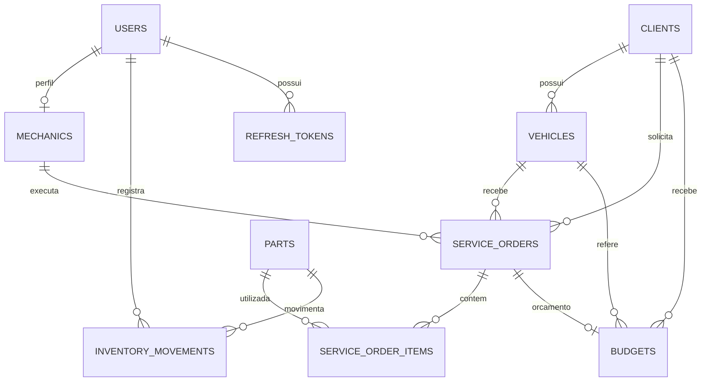

# 🔧 Torque Gestão

<p align="center">
  <strong>Gestão inteligente para oficinas mecânicas, do primeiro atendimento à conclusão do serviço.</strong>
  <br>
  Uma plataforma completa para gerenciar clientes, veículos, ordens de serviço, orçamentos, estoque e faturamento em um só lugar.
</p>

<p align="center">
  <a href="https://torque-gestao.onrender.com">
    
  </a>
  <a href="https://github.com/adanwilliamdev/torque-gestao">
    
  </a>
</p>

<p align="center">
  
  
  
  
  
</p>

---

## 🌐 Demonstração online

**Explore o sistema em funcionamento sem precisar instalar nada.**

<p align="center">
  <a href="https://torque-gestao.onrender.com">
    
  </a>
</p>

| Credencial | Acesso |
|---|---|
| **E-mail** | `demo@torquegestao.com` |
| **Senha** | `torque@gestao2026!` |

> **Atenção:** utilize a conta de demonstração para explorar as funcionalidades. Os dados podem ser compartilhados com outros visitantes e sofrer alterações. O ambiente pode apresentar demora na primeira abertura devido à hospedagem.

## 📌 Sobre o projeto

O **Torque Gestão** é uma aplicação web desenvolvida em Java 21 e Spring Boot para centralizar e simplificar a administração de oficinas mecânicas.

A plataforma integra o gerenciamento de clientes e veículos, o acompanhamento de ordens de serviço, a elaboração de orçamentos, o controle de estoque e o cálculo do faturamento. Cada operação segue regras de negócio definidas para manter a consistência das informações durante todo o ciclo de atendimento.

O sistema implementa fluxos controlados para ordens de serviço, aprovação de orçamentos, movimentações rastreáveis de estoque e cálculo automático dos valores de peças e mão de obra. Também conta com controle de concorrência para proteger a integridade dos saldos em operações simultâneas.

Na camada de segurança, utiliza Spring Security, controle de acesso por perfil, proteção CSRF na interface web e autenticação JWT com refresh tokens rotativos na API REST.

O projeto foi desenvolvido para demonstrar conhecimentos práticos em **desenvolvimento backend, arquitetura em camadas, APIs REST, segurança, persistência relacional, transações, testes automatizados e conteinerização**.

## ✨ Funcionalidades

- 👥 **Clientes:** cadastro e gerenciamento de informações.
- 🚗 **Veículos:** associação de veículos aos respectivos proprietários.
- 🔧 **Ordens de serviço:** abertura, atribuição a mecânicos e acompanhamento das etapas.
- 🧾 **Orçamentos:** elaboração, aprovação e recusa de serviços propostos.
- 💰 **Faturamento:** cálculo automático dos valores de peças e mão de obra.
- 📦 **Estoque:** controle de entradas, saídas, saldos e movimentações.
- 👨‍🔧 **Equipe técnica:** gerenciamento de mecânicos e acompanhamento das ordens atribuídas.
- 📊 **Dashboard gerencial:** visualização de informações operacionais.
- 🔐 **Controle de acesso:** permissões específicas para administradores, gerentes, recepcionistas e mecânicos.
- 🛡️ **Segurança:** sessões protegidas por CSRF e API com JWT e refresh tokens rotativos.
- 📚 **Documentação da API:** especificação OpenAPI e interface Swagger UI.
- 🐳 **Docker Compose:** ambiente conteinerizado para simplificar a execução.

## 🛠️ Stack tecnológica

| Camada | Tecnologia |
|---|---|
| Linguagem | Java 21 |
| Framework | Spring Boot 3.3 |
| Aplicação web | Spring MVC e Thymeleaf |
| Interface | HTML, CSS e JavaScript |
| API | REST, Spring MVC e springdoc-openapi |
| Persistência | Spring Data JPA e Hibernate |
| Banco de dados | PostgreSQL 16 |
| Migrações | Flyway |
| Segurança | Spring Security, JWT, refresh tokens e CSRF |
| Cache e rate limiting | Redis opcional |
| Build | Maven |
| Testes unitários | JUnit 5 e Mockito |
| Testes de integração | Testcontainers |
| Infraestrutura | Docker e Docker Compose |

## 🏗️ Arquitetura

A aplicação utiliza uma arquitetura em camadas, separando a interface, os controladores, as regras de negócio, a persistência e os mecanismos de segurança.

```text
                 ┌─────────────────────────┐
                 │      Interface Web      │
                 │        Thymeleaf        │
                 └────────────┬────────────┘
                              │
                 ┌────────────▼────────────┐
                 │      Controllers        │
                 │       Web / REST        │
                 └────────────┬────────────┘
                              │
                 ┌────────────▼────────────┐
                 │        Services         │
                 │    Regras de negócio    │
                 └────────────┬────────────┘
                              │
                 ┌────────────▼────────────┐
                 │      Repositories       │
                 │     Spring Data JPA     │
                 └────────────┬────────────┘
                              │
                 ┌────────────▼────────────┐
                 │       PostgreSQL        │
                 │  Persistência de dados  │
                 └─────────────────────────┘

 Segurança: Spring Security + JWT + CSRF
 Migrações: Flyway
 Cache / Rate Limit: Redis (opcional)
```

### Organização das responsabilidades

- **Controllers:** recebem requisições e coordenam as respostas HTTP.
- **Services:** concentram as regras de negócio e as operações transacionais.
- **Repositories:** realizam o acesso aos dados por meio do Spring Data JPA.
- **Domain:** contém as entidades e os enums do sistema.
- **Security:** implementa autenticação, filtros e autorização.
- **Migrations:** mantém o histórico de alterações do banco de dados com Flyway.

## 🔄 Fluxos e regras de negócio

### Ciclo da ordem de serviço

As ordens de serviço seguem uma sequência controlada de estados:

```text
CRIADA
   ↓
EM_DIAGNOSTICO
   ↓
AGUARDANDO_APROVACAO
   ↓
APROVADA
   ↓
EM_EXECUCAO
   ↓
FINALIZADA
```

Uma ordem aberta pode ser direcionada para `CANCELADA`, respeitando as regras de transição. Não é permitido pular etapas ou repetir o status atual, evitando alterações indevidas nos registros de início e conclusão.

### Orçamentos e aprovação

- A aprovação de um orçamento vinculado move a ordem de serviço de `AGUARDANDO_APROVACAO` para `APROVADA`.
- A recusa do orçamento cancela a ordem vinculada e devolve as peças ao estoque.
- Decisões incompatíveis com o estado atual da ordem são rejeitadas sem alterações nos dados.

Essas operações são executadas dentro de transações para manter a consistência entre orçamento, ordem de serviço e estoque.

### Controle de estoque e faturamento

- A inclusão de peças em uma ordem reduz o estoque disponível.
- O preço de venda é registrado no momento da utilização da peça.
- O total da ordem é recalculado conforme os lançamentos de peças e mão de obra.
- A remoção de peças ou o cancelamento da ordem gera estornos rastreáveis.
- Ordens finalizadas ou canceladas não permitem novas alterações de peças, mão de obra ou mecânico atribuído.

O controle de concorrência otimista protege o saldo contra atualizações simultâneas conflitantes. Quando uma atualização não pode ser aplicada com segurança, a operação pode retornar HTTP `409 Conflict`.

### Numeração e exclusões

- **Ordens de serviço:** `OSAAAA000001`.
- **Orçamentos:** `BUDAAAA000001`.
- **Sequências:** geradas pelo PostgreSQL.
- **Exclusões:** lógicas, preservando os registros com indicação de inatividade.

## 🔐 Segurança e autorização

O Torque Gestão implementa diferentes mecanismos de proteção para a interface web e a API REST.

- **Spring Security:** autenticação e autorização.
- **Controle por perfil:** restrição de operações conforme as responsabilidades do usuário.
- **JWT:** autenticação da API.
- **Refresh tokens rotativos:** renovação da sessão com substituição dos tokens.
- **CSRF:** proteção das operações da interface web.
- **Rate limiting:** limitação de tentativas de login com Redis e script Lua atômico.
- **Configuração por ambiente:** segredos e parâmetros externos ao código-fonte.
- **Validação de estados:** proteção das regras de negócio contra transições inválidas.

### Perfis de acesso

| Perfil | Responsabilidades |
|---|---|
| `ADMIN` | Acesso completo e gerenciamento de usuários. |
| `MANAGER` | Dashboard, estoque, mecânicos, clientes, acompanhamento de ordens e decisões sobre orçamentos. |
| `RECEPTIONIST` | Gestão de clientes e veículos, abertura de ordens e orçamentos e consulta de mecânicos. |
| `MECHANIC` | Consulta e atualização das ordens atribuídas, incluindo peças e mão de obra. |

O sistema não possui autocadastro. As contas são criadas por um administrador através do endpoint `POST /api/auth/users`.

O perfil `MECHANIC` pode executar e finalizar os serviços atribuídos, mas não pode aprovar nem cancelar ordens de serviço.

## 🌐 API REST

A aplicação disponibiliza endpoints para autenticação, usuários, clientes, veículos, mecânicos, ordens de serviço, orçamentos e estoque.

| Recurso | Endpoint |
|---|---|
| Interface web | `/` |
| Login | `/login` |
| API REST | `/api/**` |
| Swagger UI | `/api/swagger-ui` |
| Especificação OpenAPI | `/api/openapi.json` |
| Health check | `/api/health` |

### Paginação e filtros

As listagens principais de clientes, ordens de serviço e peças do estoque oferecem paginação.

Exemplo de resposta:

```json
{
  "content": [],
  "page": 0,
  "size": 20,
  "totalElements": 134,
  "totalPages": 7
}
```

| Parâmetro | Descrição |
|---|---|
| `page` | Página solicitada, iniciando em `0`. |
| `size` | Quantidade por página, padrão `20`, máximo `100`. |
| `sort` | Ordenação, por exemplo `sort=name,asc`. |
| `name` | Filtro por nome de cliente ou peça. |
| `status` | Filtro por status da ordem de serviço. |

A ordenação utiliza campos permitidos. Valores inválidos retornam à ordenação padrão `createdAt desc`.

## 🗄️ Modelo de dados

O modelo relacional representa os principais elementos do negócio e seus relacionamentos.



## 🧪 Testes e qualidade

A aplicação possui testes unitários e de integração para validar regras de negócio, permissões, operações transacionais e consistência dos dados.

| Tipo | Cobertura | Execução |
|---|---|---|
| Unitários | Regras das ordens, cancelamentos, estornos e permissões | `mvn test` |
| Integração | API, segurança por perfil, paginação e interface web | `mvn verify` |
| Concorrência | Atualizações simultâneas de estoque | `mvn verify` |

**Tecnologias de teste:**
- JUnit 5 e Mockito para testes unitários.
- Testcontainers com PostgreSQL para testes de integração.
- JaCoCo para geração de relatórios de cobertura.

Após executar `mvn verify`, o relatório de cobertura fica disponível em `target/site/jacoco/index.html`.

O workflow de CI em `.github/workflows/ci.yml` executa `mvn verify` e a construção da imagem Docker em pushes e pull requests.

## 🚀 Como executar localmente

### Pré-requisitos

- JDK 21.
- Maven 3.9 ou superior.
- Docker e Docker Compose para execução conteinerizada.
- PostgreSQL 16 para execução local sem Docker.
- Redis opcional.

### Opção 1: Docker Compose

Clone o repositório:

```bash
git clone https://github.com/adanwilliamdev/torque-gestao.git
cd torque-gestao
```

Inicie a aplicação:

```bash
docker compose up --build
```

Acesse:

```text
http://localhost:8080
```

Na primeira inicialização, a aplicação cria um administrador inicial conforme as configurações de ambiente.

- Sem `SEED_ADMIN_PASSWORD`, uma senha aleatória é gerada e exibida uma única vez nos logs, em ambientes que permitem essa inicialização.
- Para definir a senha inicial, configure `SEED_ADMIN_PASSWORD` antes de iniciar os serviços.
- Em produção, o sistema exige uma senha inicial forte e rejeita o segredo JWT de exemplo.

Consulte os arquivos `.env.example` e `docker-compose.yml` para conhecer as configurações disponíveis.

### Opção 2: execução local

Crie o banco de dados PostgreSQL:

```bash
createdb torque
```

Configure as variáveis de ambiente conforme `.env.example` e execute:

```bash
mvn spring-boot:run
```

O Flyway aplica automaticamente as migrações durante a inicialização.

## ⚙️ Configuração por variáveis de ambiente

As configurações podem ser ajustadas sem alterar o código-fonte.

| Variável | Valor padrão ou referência | Finalidade |
|---|---|---|
| `DB_URL` | `jdbc:postgresql://localhost:5432/torque` | Conexão com o banco de dados. |
| `DB_USER` | `postgres` | Usuário do PostgreSQL. |
| `DB_PASSWORD` | `postgres` | Senha do banco. |
| `REDIS_HOST` | `localhost` | Endereço do Redis. |
| `REDIS_PORT` | `6379` | Porta do Redis. |
| `JWT_SECRET` | Placeholder apenas para desenvolvimento | Segredo de assinatura dos tokens. |
| `JWT_EXPIRATION_MS` | `900000` | Validade do access token, em milissegundos. |
| `ENVIRONMENT` | `development` | Ambiente de execução. |
| `CORS_ALLOWED_ORIGINS` | `http://localhost:8080` | Origens autorizadas para a API. |
| `SEED_ADMIN_EMAIL` | `admin@torquegestao.com` | E-mail do administrador inicial. |
| `SEED_ADMIN_PASSWORD` | Vazio | Senha inicial do administrador. |
| `APP_TIMEZONE` | `America/Sao_Paulo` | Fuso horário da aplicação. |

Em produção, configure `ENVIRONMENT=production`, utilize um `JWT_SECRET` forte com pelo menos 32 caracteres e defina uma senha inicial segura quando o seed do administrador for necessário.

O access token possui validade padrão de 15 minutos. A renovação utiliza refresh tokens com validade de 7 dias e rotação.

> Nunca publique segredos reais, senhas de produção ou arquivos `.env` no repositório.

## 📁 Estrutura do projeto

```text
torque-gestao/
├── .github/
│   └── workflows/
│       └── ci.yml
├── src/
│   ├── main/
│   │   ├── java/com/torquegestao/
│   │   │   ├── api/          # Controllers REST e erros
│   │   │   ├── web/          # Controllers e formulários web
│   │   │   ├── service/      # Regras de negócio
│   │   │   ├── repository/   # Persistência JPA
│   │   │   ├── domain/       # Entidades e enums
│   │   │   ├── dto/          # Contratos de dados
│   │   │   ├── security/     # JWT e autorização
│   │   │   ├── config/       # Configurações e seed
│   │   │   └── exception/    # Exceções de negócio
│   │   └── resources/
│   │       ├── db/migration/ # Migrações Flyway
│   │       ├── templates/    # Páginas Thymeleaf
│   │       └── static/      # CSS e JavaScript
│   └── test/                 # Testes unitários e integração
├── .env.example
├── Dockerfile
├── docker-compose.yml
└── pom.xml
```

## 🎯 Objetivos técnicos

O desenvolvimento do Torque Gestão teve como foco a aplicação prática de:

- Desenvolvimento backend com Java 21 e Spring Boot.
- Construção e documentação de APIs REST.
- Arquitetura em camadas e separação de responsabilidades.
- Autenticação e autorização com Spring Security e JWT.
- Gerenciamento de sessões com refresh tokens rotativos.
- Modelagem relacional e migrações versionadas com Flyway.
- Implementação de regras de negócio e máquinas de estados.
- Transações e consistência entre operações relacionadas.
- Controle de concorrência e integridade de estoque.
- Testes unitários, testes de integração e cobertura automatizada.
- Conteinerização e configuração por variáveis de ambiente.
- Integração contínua com GitHub Actions.

## 👨‍💻 Desenvolvido por

**Adan William Oliveira Santos**

Desenvolvedor Backend Júnior com foco em Java e Spring Boot, interessado em arquitetura de software, APIs REST, segurança de aplicações e construção de sistemas confiáveis.

<p align="center">
  <a href="https://github.com/adanwilliamdev">
    
  </a>
  <a href="https://www.linkedin.com/in/adan-william-9593163b7/">
    
  </a>
  <a href="https://adanwilliamdev.github.io/">
    
  </a>
</p>

---

<p align="center">
  <strong>Torque Gestão</strong>
  <br>
  Tecnologia, organização e controle para uma gestão de oficina mais eficiente.
</p>
